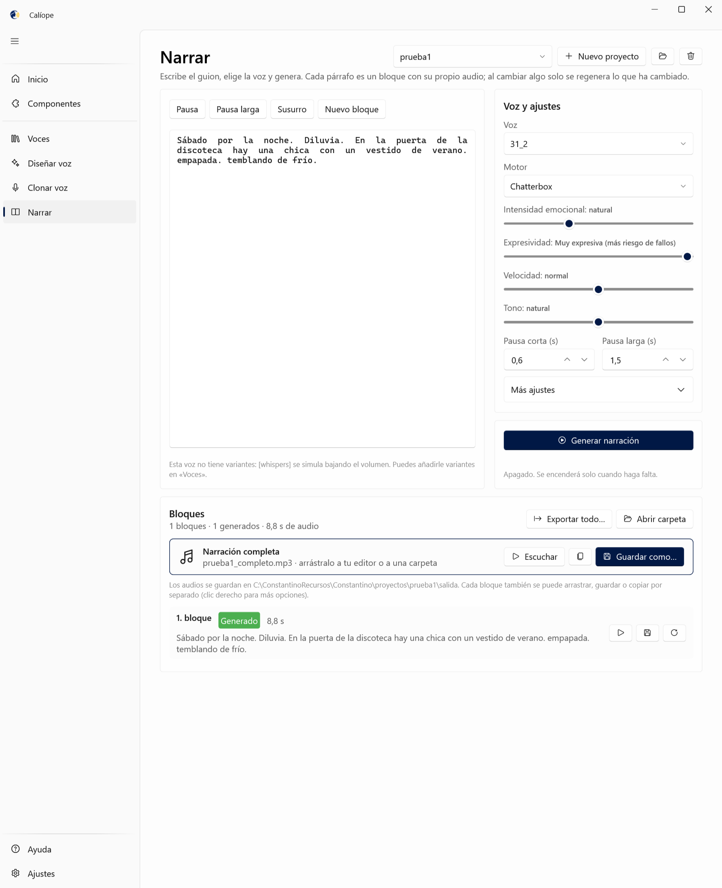
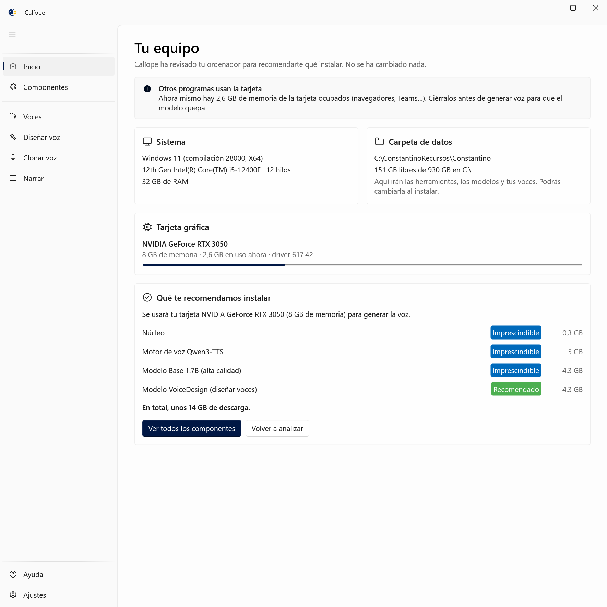
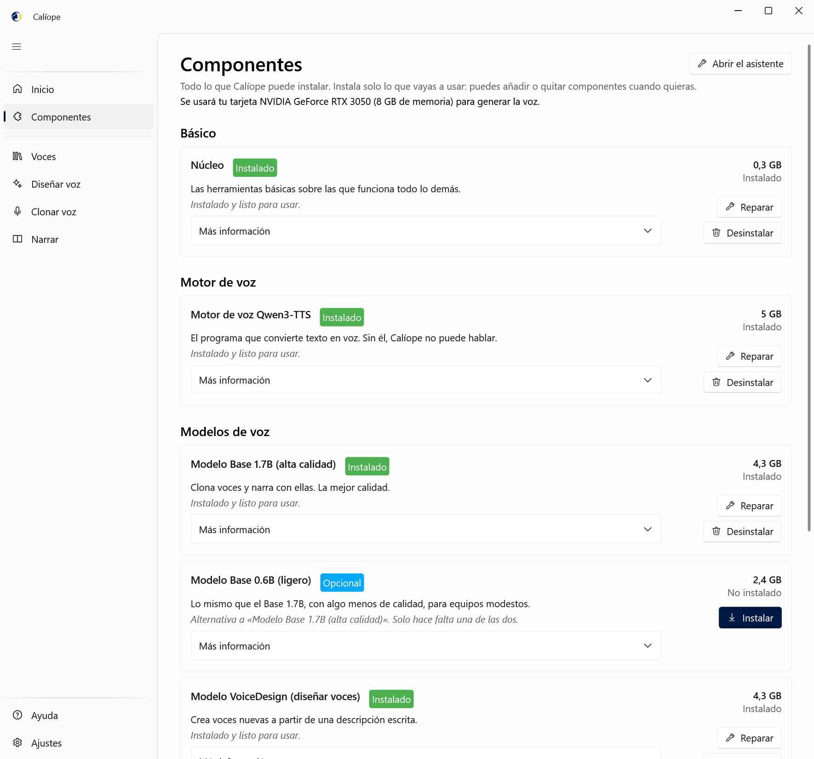
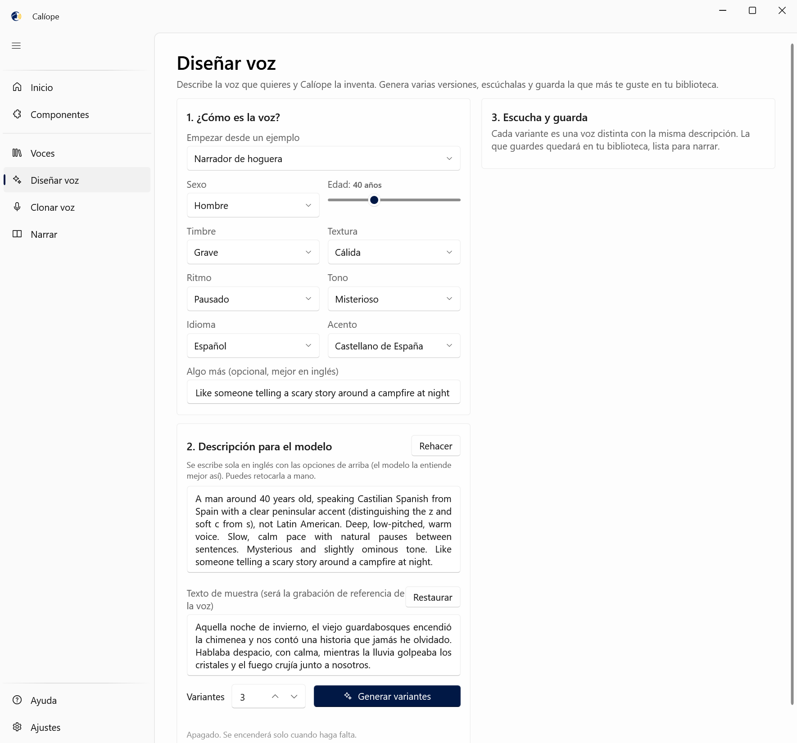

<p align="center">
  
</p>

<h1 align="center">Calíope</h1>

<p align="center">
  <b>Tu estudio de voces en el ordenador: diseña voces, clónalas y narra guiones completos.</b><br>
  Sin conexión, sin cuentas y sin pagar por minuto. Para Windows.
</p>

<p align="center">
  <a href="https://github.com/rboluda/Caliope/releases/latest"><b>⬇ Descargar el instalador</b></a> ·
  <a href="#cómo-se-usa">Cómo se usa</a> ·
  <a href="#preguntas-frecuentes">Preguntas frecuentes</a>
</p>

---

## ¿Para qué sirve?

> **Calíope es una suite que reúne herramientas de código abierto de terceros** —[Qwen3-TTS](https://github.com/QwenLM/Qwen3-TTS), [Chatterbox](https://github.com/resemble-ai/chatterbox), [Whisper](https://github.com/openai/whisper), [PyTorch](https://pytorch.org), [FFmpeg](https://ffmpeg.org) y otras— y las hace fáciles de usar: las instala, las coordina y les pone una interfaz sencilla. Los motores y modelos de voz son obra de sus autores; Calíope no los incluye, los descarga de sus fuentes oficiales cuando lo pides. Ver [créditos](#créditos-y-licencias).

Calíope convierte texto en voz con modelos de inteligencia artificial que **se ejecutan en tu propio equipo**. Está pensado para quien necesita locuciones a menudo: vídeos de YouTube o TikTok, pódcast, audiolibros, cuentos, cursos, presentaciones o videojuegos. Es una alternativa local a servicios como ElevenLabs.

- 🎨 **Diseña voces nuevas** describiéndolas con palabras: «hombre de 40 años, voz grave y cálida, ritmo pausado, tono misterioso, castellano de España».
- 🎙️ **Clona una voz** a partir de 10 a 20 segundos de grabación: la tuya o la de alguien que te haya dado permiso. Puedes grabarla con el micrófono desde la propia aplicación, y con Whisper la transcripción se escribe sola.
- 📖 **Narra guiones largos** por párrafos, con pausas, susurros y cambios de emoción marcados en el texto. Si cambias una frase, solo se vuelve a generar ese párrafo.
- 🎭 **Variantes de una misma voz**: susurrando, tensa, asustada, triste, alegre o gritando.
- 🎚️ **Afina el resultado**: expresividad, velocidad y tono (independientes entre sí), pausas y volumen normalizado para vídeo o pódcast.
- 📤 **Saca el audio en MP3 o WAV** o arrástralo directamente a tu editor de vídeo.
- 🔒 **Todo es privado**: ni tus textos ni tus voces salen del ordenador. Internet solo se usa para descargar los componentes.
- 🧩 **Instalación con botones**: un asistente mira qué equipo tienes y te propone qué descargar. No hace falta tocar Python ni la línea de comandos.

<p align="center">
  
</p>

## Requisitos

| | Mínimo | Recomendado |
|---|---|---|
| Sistema | Windows 10 (1809) o 11, 64 bits | Windows 11 |
| Tarjeta gráfica | Ninguna (funciona con el procesador, mucho más despacio) | NVIDIA con 6 GB o más (RTX 3050 de 8 GB o superior) |
| Memoria | 8 GB de RAM | 16 GB o más |
| Disco | 10 GB libres | 25 GB libres (si instalas todos los motores) |

Con una tarjeta NVIDIA de 4 GB funciona usando el modelo ligero (0.6B). El motor opcional Chatterbox no es compatible con la serie RTX 50.

## Instalación

1. Descarga **`Caliope-x.y.z-Instalador.exe`** desde [Releases](https://github.com/rboluda/Caliope/releases/latest).
2. Ábrelo y sigue los pasos. No necesita permisos de administrador, y .NET va incluido.
   - Si Windows SmartScreen avisa de que el programa no es conocido, pulsa *Más información → Ejecutar de todas formas*. El instalador no está firmado digitalmente.
3. Al abrir Calíope por primera vez, el **asistente** analiza tu equipo y te propone qué instalar. Cada componente explica qué hace, cuánto ocupa y si es imprescindible.

<p align="center">
  
  
</p>

El instalador solo ocupa unos 50 MB. Los motores y modelos se descargan después, desde la aplicación:

| Componente | ¿Hace falta? | Para qué | Tamaño |
|---|---|---|---|
| Núcleo (uv, Python, ffmpeg) | Imprescindible | La base de todo lo demás | 0,3 GB |
| Motor Qwen3-TTS | Imprescindible | Genera la voz | 1,2–5 GB |
| Modelo Base 1.7B **o** 0.6B | Imprescindible (uno de los dos) | Clonar voces y narrar | 4,3 / 2,4 GB |
| Modelo VoiceDesign | Recomendado | Diseñar voces nuevas | 4,3 GB |
| Whisper | Opcional | Transcribir grabaciones al clonar | 1,6 GB |
| Chatterbox | Opcional | Motor alternativo con control de la emoción | 4,9–8,4 GB |

## Cómo se usa

1. **Consigue una voz.** Puedes diseñarla en «Diseñar voz», clonarla en «Clonar voz» o importar una grabación en «Voces».
2. **Escribe el guion** en «Narrar», elige la voz y pulsa «Generar narración».
3. **Escucha y retoca.** Cada párrafo es un bloque: puedes regenerar solo el que no te guste.
4. **Saca el audio** con «Guardar como…», arrastrándolo a tu editor o con «Exportar todo…».

<p align="center">
  
</p>

### Marcas del guion

```text
# inicio
Era sábado por la noche. [pause] Diluviaba.

# susto
Alguien llamó a la puerta. [long pause]
[whispers] No abras. [normal] Pero ella abrió.
[asustado] ¿Quién anda ahí?
```

| Marca | Qué hace |
|---|---|
| `[pause]` / `[long pause]` | Pausa corta o larga (ajustables) |
| `[whispers]` | Susurra hasta el final de la línea |
| `[asustado]`, `[tenso]`, `[alegre]`… | Lee con esa variante de la voz hasta el final de la línea |
| `[normal]` | Vuelve a la voz normal |
| `# nombre` | Nombra el bloque (y su archivo) |
| `// nota` | Comentario, no se lee |
| Línea en blanco | Empieza un bloque nuevo |

Dentro de la aplicación tienes una sección de **Ayuda** con todo esto, con los ajustes explicados y con soluciones a los problemas más comunes.

## Motores de voz

| | Qwen3-TTS (principal) | Chatterbox (opcional) |
|---|---|---|
| Autor y licencia | Alibaba Qwen, Apache 2.0 | Resemble AI, MIT |
| Clonar voces | ✅ Muy fiel, usa la transcripción | ✅ Solo con la grabación |
| Diseñar voces | ✅ (VoiceDesign) | — |
| Control de la emoción | Variantes de la voz | Variantes + intensidad emocional |
| Pausas | Respeta bien las pausas naturales | Lee más seguido |
| Marca de agua | No | Sí, inaudible |

En «Voces → Probar» puedes escuchar la misma voz con los dos motores y quedarte con el que prefieras.

## Preguntas frecuentes

**¿Necesito internet?** Solo para descargar los componentes la primera vez. Después funciona sin conexión.

**¿Cuánto tarda?** Con una RTX 3050, unos segundos por frase. La primera generación tarda entre 20 y 60 segundos más, mientras carga el modelo. Sin tarjeta NVIDIA funciona, pero bastante más despacio.

**La voz clonada sale cortada.** Casi siempre es porque la transcripción no coincide con la grabación. Corrígela en «Voces → Editar transcripción» o déjala vacía para imitar solo el timbre.

**¿Dónde se guardan mis voces y narraciones?** En la carpeta que eliges en el asistente (por defecto `%LOCALAPPDATA%\Caliope`), organizada para que se entienda a simple vista:

```text
Mis narraciones\      tus proyectos; el audio de cada uno está en su carpeta «Audio»
Mis voces\            tus voces y sus variantes
Modelos de voz\       lo que más ocupa
Programas internos\   motores y herramientas (no tocar)
LÉEME.txt
```

En *Ajustes → Almacenamiento* ves cuánto ocupa cada parte y puedes abrirla.

**¿En qué idiomas habla?** Español, inglés, francés, alemán, italiano, portugués, ruso, chino, japonés y coreano. Puedes elegir acento, por ejemplo castellano de España o español latino.

## Uso responsable

Clona solo tu voz o la de personas que te hayan dado **permiso expreso**: Calíope te pide confirmarlo antes de clonar. No uses voces sintéticas para suplantar a nadie, engañar ni difamar, y avisa de que una voz es sintética cuando pueda confundir a quien la escucha.

## Para desarrolladores

Calíope está hecho en C# con .NET 10, WPF y [WPF-UI](https://github.com/lepoco/wpfui). Los motores de voz corren en procesos de Python aislados, cada uno con su propio entorno, que la aplicación instala con [uv](https://github.com/astral-sh/uv).

```
dotnet build
dotnet test
dotnet run --project src/Constantino.App
pwsh instalador/crear-instalador.ps1   # crea el instalador (necesita Inno Setup 6)
```

Hay más detalles en [docs/DESARROLLO.md](docs/DESARROLLO.md) (estructura, protocolo del motor, historia) y en [docs/DISENO.md](docs/DISENO.md) (diseño completo).

## Créditos y licencias

Calíope existe gracias al trabajo de otros. Las piezas principales:

| Herramienta | Autor | Licencia | Para qué |
|---|---|---|---|
| [Qwen3-TTS](https://github.com/QwenLM/Qwen3-TTS) | Alibaba (equipo Qwen) | Apache 2.0 | Motor de voz principal: clonar, diseñar y narrar |
| [Chatterbox Multilingual](https://github.com/resemble-ai/chatterbox) | Resemble AI | MIT | Motor alternativo con control de la emoción |
| [Whisper](https://github.com/openai/whisper) | OpenAI | MIT | Transcripción y revisión automática |
| [PyTorch](https://pytorch.org) | PyTorch Foundation | BSD-3 | Ejecutar los modelos |
| [FFmpeg](https://ffmpeg.org) y [Rubber Band](https://breakfastquay.com/rubberband/) | FFmpeg · Breakfast Quay | GPL | Audio: volumen, velocidad, tono, mezcla |
| [uv](https://github.com/astral-sh/uv) y [Python](https://www.python.org) | Astral · PSF | MIT/Apache 2.0 · PSF | Entornos de los motores |
| [WPF-UI](https://github.com/lepoco/wpfui), [.NET](https://dotnet.microsoft.com), [NAudio](https://github.com/naudio/NAudio) | lepo.co · Microsoft · Mark Heath | MIT | La aplicación |

La lista completa, con lo que hace cada una, está en [TERCEROS.md](TERCEROS.md) y dentro de la aplicación, en *Ajustes → Acerca de Calíope*. Calíope no redistribuye los motores ni los modelos: los descarga de sus fuentes oficiales y te muestra cada licencia antes de instalar.

El código de Calíope, su logotipo y los sonidos que crea se publican bajo la [licencia MIT](LICENSE). Hecho por [rboluda](https://github.com/rboluda).
